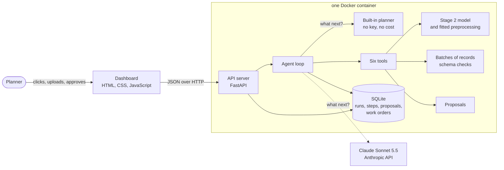

# AcuMain

**An AI assistant that turns actuator failure predictions into a reviewed maintenance action list.**

Team Maze, Al Ain University. AI for Smart Maintenance Hackathon (MoIAT × GAL), Case 1: Boeing 787 nose landing gear hydraulic actuators.

| | |
|---|---|
| **User** | The fleet maintenance planning manager |
| **Their problem** | Thousands of diagnostic records, limited hangar slots, limited time to read them |
| **The decision AcuMain supports** | Which actuators to repair, inspect or re-test now, and in what order |
| **How** | An agent checks the records, runs our trained Stage 2 model, drafts an action list with reasons, and waits for the planner's approval |
| **What is simulated** | Work orders. Approving an action creates a work order inside AcuMain only. No aircraft or maintenance system is contacted. |

---

## Run it

### 1. What you need

- **Docker Desktop** (or Docker Engine with the Compose plugin), version 24 or newer.
- **Nothing else to try it.** With no API key the agent runs with its built-in planner, at no cost. The dashboard, the model, the tools, the approvals and the activity log all work.
- **Optional: an Anthropic API key**, to let Claude (Sonnet 5.5) decide the agent's steps and write the summaries. This needs internet access to `api.anthropic.com`. No other external service is used.

### 2. Configure (optional)

Skip this step to run without a key.

```bash
cp .env.example .env
```

Then open `.env` and put the key after `ANTHROPIC_API_KEY=`. The file is ignored by Git.

| Variable | Default | Meaning |
|---|---|---|
| `ANTHROPIC_API_KEY` | empty | The key for Claude. Empty means the built-in planner is used. |
| `ACUMAIN_AGENT_MODE` | `auto` | `auto` uses Claude when a key is set. `offline` never calls Claude. |
| `ACUMAIN_MODEL` | `claude-sonnet-5-5` | The Claude model the agent uses. |
| `ACUMAIN_EFFORT` | `medium` | How much the model thinks: `low`, `medium` or `high`. |
| `ACUMAIN_DAILY_USD_LIMIT` | `10` | Claude spend allowed per day. After that the built-in planner takes over. |
| `ACUMAIN_RUN_USD_LIMIT` | `0.50` | Claude spend allowed for one run. |
| `ACUMAIN_PUBLISHED_PORT` | `8787` | The port on your machine. |

Two more settings exist for tuning and are not in the Compose file: `ACUMAIN_MAX_STEPS` (default 12 decisions per run) and `ACUMAIN_PLANNER_PACE_MS` (default 450, the pause between the built-in planner's steps so they can be followed on screen; the planner itself answers instantly).

### 3. Build and start

```bash
docker compose up --build
```

To stop it:

```bash
docker compose down
```

### 4. Open the dashboard

**http://localhost:8787**

No login. The interactive API documentation is at http://localhost:8787/docs.

### 5. Check that everything works

A command-line check of the model, the tools, the agent and the approvals (no key needed, a few seconds):

```bash
docker compose exec acumain python -m acumain.selfcheck
```

With a key in `.env`, this also sends one tiny request to Claude to prove the key works (well under one cent):

```bash
docker compose exec acumain python -m acumain.selfcheck --claude
```

Then in the dashboard:

1. **Review queue** shows 2,000 records marked *Awaiting model*. These are the organisers' Stage 2 test records.
2. Click **Prepare action list**. The agent checks the data, runs the model and files its proposals. You should see **203 predicted to fail** and 25 proposed actions.
3. Click a record to see why: the risk, the readings compared with a new actuator, what adds to the risk, and how similar records ended in the training data.
4. **Approve** a proposal. A simulated work order `WO-SIM-0001` is created and appears under **Decisions**. Nothing is created before you approve.
5. Open **Activity log** and click the run. Every decision and every tool call is there with its exact input and output.
6. **A failed model call.** In the sidebar open *Demo controls*, switch on *Simulate a model outage*, and click *Prepare the list again*. The agent reports the failure, proposes nothing and invents no prediction. Switch the outage off and run again: it recovers.
7. **Your own data.** Click **Add records**. Download the 30-record sample file from the dialog and upload it, or use *Check one record* and clear the leakage reading: the model still answers, marked as reduced confidence. Clear both key readings and it refuses to predict.

---

## How it is built



**The data flow for one review**

1. The planner clicks *Prepare action list*. The dashboard sends the batch, the list size, any selected records and what is on screen.
2. The server starts a run and hands the task to the agent loop.
3. The loop asks "what next?". With a key, Claude answers; without one, the built-in planner does. The answer is either a tool call or the final summary.
4. The loop runs the tool, records its input, output, duration and any error, and gives the result back. This repeats until there is a summary, or a step or spend limit is reached.
5. Proposals wait in the dashboard. The planner approves or rejects each one. Only an approval creates a (simulated) work order.

### The tools the agent can call

| Tool | What it does |
|---|---|
| `check_records` | Reports data quality: complete records, missing or unusable readings, records that cannot be scored |
| `run_failure_model` | Runs the trained Stage 2 model with its fitted preprocessing and returns counts by risk level and the highest-risk records |
| `list_records` | Lists scored records, highest risk first, by level or with missing readings |
| `get_record` | Everything about one record: readings against a new actuator, what drives the risk, history of similar records |
| `get_model_track_record` | The model's validation results and limits |
| `propose_actions` | Files proposed actions for approval. It executes nothing. |

The agent has no other abilities. It cannot approve, cannot create a work order, and cannot reach any batch except the one the run was started on.

### Design choices

- **The model is the only source of predictions.** If the model call fails, the tool returns an error and the agent is told there are no predictions. It reports that and stops. This is tested.
- **Records stay on the server.** Tools return short summaries, not the 2,000 records, so each request to Claude is small. The system prompt and tool list are fixed and cached, so later steps re-read them at a tenth of the price.
- **A hand-written loop instead of the SDK's tool runner**, so that each step is logged as it happens, the spend limit is checked before each paid call, and the same loop runs against the built-in planner and against scripted replies in the tests.
- **Claude can fail without stopping the planner's work.** A rejected key, no internet, a rate limit, a refusal, a cut-off reply or a reached spend limit hands the run to the built-in planner, which continues from the tool results already in hand. The log says what happened.
- **Missing inputs are reported, not hidden.** A missing reading still gets a prediction, marked as reduced confidence. A record missing both key readings gets no prediction at all, and the suggested step is to repeat the test.
- **Human approval is the only way anything is executed**, and what is executed is simulated.
- **Uploaded text cannot make the agent act.** Record IDs and aircraft names from a file are data. Even if one contained instructions, the agent has no tool that approves or executes, and the dashboard shows every such value as plain text.

### The model

- Trained on the Stage 2 data: 10,000 weekly records from 100 aircraft. 75% logistic regression with squared and pairwise terms, 25% small gradient-boosted trees (LightGBM).
- The key step is dividing the raw readings by the reference settings of each test. `risk_model/stage2/STAGE2.md` explains it in plain English.
- Checked on aircraft the model never saw (5 folds, 4 repeats): **F1 70.9, precision 66.2%, recall 76.3%, accuracy 95.0%**.
- Counted per failure: **185 of 187 real failures were flagged in their final 30 days**, typically 5 weeks ahead.
- The app loads the saved model and reproduces `submission/case_1_predictions.csv` exactly. A test checks this.
- The **Track record** page replays all of it week by week against what really happened.

### Tests

```bash
pip install -r requirements.txt
python -m pytest tests -q
```

83 tests, none of which needs an API key or spends anything. They cover the input checks (wrong columns, semicolon files, decimal commas, non-numbers, out-of-range values), the model service, every tool, the agent loop end to end, approvals, and the HTTP API. The Claude integration is tested by pointing the real Anthropic SDK at a fake endpoint, which checks the exact request the app sends and how it reads the replies.

### Run without Docker

```bash
python -m venv .venv
.venv\Scripts\pip install -r requirements.txt      # Windows; on macOS or Linux use .venv/bin/pip
.venv\Scripts\python -m acumain --open
```

On Windows you can also double-click `run_dashboard.bat`.

### Rebuild the model and the app's data

```bash
python risk_model/stage2/case1.py          # trains, validates, writes submission/case_1_predictions.csv
python -m acumain.build_artifacts          # writes acumain/artifacts/ for the app
```

---

## Limits

- Each prediction uses one diagnostic record, not the actuator's history. Readings four and six weeks before a failure look alike, so about one Yes in three is early.
- A Yes is a reason to review, not a confirmed failure. A No is not a guarantee.
- Work orders are simulated. Nothing here is connected to a real maintenance system.
- The datasets are synthetic and for this hackathon. This is not guidance for real aircraft maintenance.

## Folders

| Path | Contents |
|---|---|
| `acumain/` | The app: `api.py` (server), `services.py`, `model.py`, `schema.py`, `batches.py`, `store.py`, and `agent/` (tools, loop, Claude and built-in planner, prompt) |
| `acumain/web/` | The dashboard |
| `acumain/artifacts/` | The trained model with its fitted preprocessing, reference numbers, the track-record data and the sample records |
| `tests/` | The test suite |
| `risk_model/stage2/` | The training pipeline (`case1.py`), its report and scores, and `STAGE2.md` |
| `submission/` | `case_1_predictions.csv`, the Stage 2 predictions |
| `data/` | The datasets and briefs from the organisers |
| `Dockerfile`, `docker-compose.yml`, `.env.example` | The Docker package |
| `dashboard/`, `deliverables/`, `demo/`, `risk_model/risk_model.py` | Day 1 work on the first, 36-row dataset, kept for reference. `dashboard/static` is the public static replay at acumain.vercel.app. |
