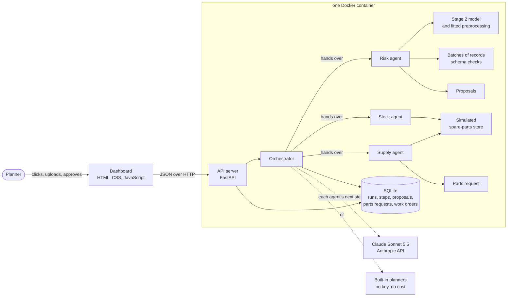

# AcuMain

**A team of AI agents that turns actuator failure predictions into a reviewed maintenance action list.**

Team Maze, Al Ain University. AI for Smart Maintenance Hackathon (MoIAT × GAL), Case 1: Boeing 787 nose landing gear hydraulic actuators.

**Public replay, no install:** https://acumain.vercel.app shows reviews that were run by the real agents and the trained model and then recorded. It is a static copy: aircraft are relabelled, approvals stay in the visitor's browser, and new reviews, uploads and questions need the Docker package below. The Docker package is the working solution.

| | |
|---|---|
| **User** | The fleet maintenance planning manager |
| **Their problem** | Thousands of diagnostic records, limited hangar slots, limited time to read them |
| **The decision AcuMain supports** | Which actuators to repair, inspect or re-test now, and in what order |
| **How** | A team of four agents. An orchestrator hands the work out. The Risk agent checks the records and runs our trained Stage 2 model. The Stock agent checks which repairs have a spare part. The Supply agent requests the missing parts, with delivery times. The planner approves or rejects every action and the parts request. |
| **What is simulated** | Work orders, the spare-parts stock and the supply department. The datasets contain no inventory, so the stock is a labelled stand-in that can be changed from the Demo menu. Approving creates a work order inside AcuMain only. No aircraft, maintenance or inventory system is contacted, and nothing is ever ordered. |

---

## Run it

### 1. What you need

- **Docker Desktop** (or Docker Engine with the Compose plugin), version 24 or newer.
- **Nothing else to try it.** With no API key the agent runs with its built-in planner, at no cost. The dashboard, the model, the tools, the approvals and the activity log all work.
- **Optional: an Anthropic API key**, to let Claude (Sonnet 5.5) decide the agent's steps and write the summaries. This needs internet access to `api.anthropic.com`. No other external service is used.

### 2. Configure (optional)

Skip this step to run without a key.

```bash
cp .env.example .env
```

Then open `.env` and put the key after `ANTHROPIC_API_KEY=`. The file is ignored by Git.

| Variable | Default | Meaning |
|---|---|---|
| `ANTHROPIC_API_KEY` | empty | The key for Claude. Empty means the built-in planner is used. |
| `ACUMAIN_AGENT_MODE` | `auto` | `auto` uses Claude when a key is set. `offline` never calls Claude. |
| `ACUMAIN_MODEL` | `claude-sonnet-5-5` | The Claude model the agent uses. |
| `ACUMAIN_EFFORT` | `medium` | How much the model thinks: `low`, `medium` or `high`. |
| `ACUMAIN_DAILY_USD_LIMIT` | `10` | Claude spend allowed per day. After that the built-in planner takes over. |
| `ACUMAIN_RUN_USD_LIMIT` | `0.50` | Claude spend allowed for one run. |
| `ACUMAIN_PUBLISHED_PORT` | `8787` | The port on your machine. |

**What a run costs with a key** (measured on 11 Nov 2026, Sonnet 5.5, medium effort, the 2,000-record sample):

| Run | Tool calls | Time | Cost |
|---|---|---|---|
| Review by the whole team, 25-action list, stock short | 11 | 37 to 47 s | $0.07 |
| One typed record, reviewed by the whole team | 7 | 26 s | $0.02 |
| Review by the Risk agent alone (`"team": false`) | 4 | 45 s | $0.03 |
| A question about one record | 2 | 9 s | $0.01 |
| Review during a model outage (nothing proposed) | 2 | 9 s | $0.01 |

Most of the input is read from the prompt cache (66% in the team review above). The four agents share one spend limit per run. Every run's tokens and cost are shown in the **Agent activity log**.

Two more settings exist for tuning and are not in the Compose file: `ACUMAIN_MAX_STEPS` (default 12 decisions per run) and `ACUMAIN_PLANNER_PACE_MS` (default 450, the pause between the built-in planner's steps so they can be followed on screen; the planner itself answers instantly).

### 3. Build and start

```bash
docker compose up --build
```

To stop it:

```bash
docker compose down
```

### 4. Open the dashboard

**http://localhost:8787**

No login. The interactive API documentation is at http://localhost:8787/docs.

### 5. Check that everything works

A command-line check of the model, the tools, the agent and the approvals (no key needed, a few seconds):

```bash
docker compose exec acumain python -m acumain.selfcheck
```

With a key in `.env`, this also sends one tiny request to Claude to prove the key works (well under one cent):

```bash
docker compose exec acumain python -m acumain.selfcheck --claude
```

Then in the dashboard:

1. The start screen asks **"Which aircraft get this week's hangar slots?"**. On its right, a short example of a review plays in a loop, so you can see what the team does before you start. Click **Start the review** in the blue **Use the sample fleet file** card (marked *Start here*). These are the organisers' 2,000 Stage 2 test records. The review starts at once (a file that was reviewed before opens on a replay of its last review instead, and the button then reads *Watch the team review it*).
2. **Watch the team work.** The screen has two layers that move together. Above, the planner, the orchestrator, the Risk, Stock and Supply agents and the failure model are boxes joined by wires. Every message of the run travels along its wire as an arrow from the sender to the receiver, with a small label of what is being sent: the task, the tool call (`run_failure_model`, `check_stock`, ...), the result coming back, the report, the summary. Below, the same messages change your fleet: every aircraft is a dot, the failure model colours and ranks them, the 25 most urgent move onto this week's list, spare parts come off the shelf, and the missing ones are requested from the supply department. **The conversation** on the right lists every message with what came back. Nothing is scripted: each message is a logged step of the run, and each dot is a record of the file (point at one to see which aircraft it is and its risk).
   Under the picture are **Pause**, **next message**, the speed, and a bar with one segment per message. **Every step and tool call** underneath shows the exact inputs and outputs.
3. The result reads **"203 of 2,000 actuators are likely to fail within 30 days"**, with 25 actions and one parts request waiting for a decision. **Watch the team at work** at the top replays the review: there you can also step back, click any message or any segment of the bar to jump to it, click an agent to pick out its messages, and click a dot to open that aircraft's record.
4. Click an aircraft in the list to see why: the risk, the readings compared with a new actuator, what adds to the risk, and how similar records ended in the training data. **Suggested next step** in that panel opens the planner's steps for that action: what to do, by when, and why. The steps are written by fixed rules from the model's own result, not generated.
   At the top of the panel is a **hologram** of the Boeing 787 and its nose landing gear. It is drawn from this record's own readings: the retraction actuator is coloured by the risk level, fluid drips at the seal when the leakage reading is high, and the gear swings slower than the outline of a new actuator when the operation time is slow. **Aircraft** and **Actuator** switch between the whole aircraft and the close-up, **Enlarge** opens it in a window, and it can be dragged and zoomed. It is an illustration on a Boeing 787-8 outline, not a scan, and says so.
5. Click **Decide** on an action. A small window shows three facts (the risk, why, and where the spare part comes from) and two buttons. **Approve** creates a simulated work order `WO-SIM-0001`, which appears under **Work orders**. **Reject** asks **Are you sure?** once, says what it means (no work order, and the risk the aircraft stays at), and then rejects; no reason is asked. *Approve all* asks first and says how many repairs have no part yet. Nothing is created before you approve.
   **A decision can be changed.** Every decided row has a **Change** link. Changing an approval to a rejection cancels its work order (it stays on the Work orders page, marked *Cancelled*) and gives the spare part back; changing a rejection to an approval creates a new work order. The parts request is decided and changed the same way.
   Then click **Decide** on the parts request above the list: it shows what the Supply agent asks for, from where, in how many days, and which parts would arrive after the repair is due.
6. Open **Model and log**, then **Agent activity log**, and click the run. Every decision and every tool call is there with its exact input and output.
7. **A failed model call.** Open **Demo** in the top bar, switch on *Simulate a model outage*, go back to **Review** and click *Prepare the list again* under the action list. The picture shows the failure model not answering, the page then says the review could not be completed, nothing is proposed and no prediction is invented. Click *Switch the failure model back on*, then *Try again*: it recovers.
   **Other stock situations**, also under **Demo**: *Plenty* (every repair has a part, so the orchestrator does not call the Supply agent), *Short* (the default: 12 in the hangar store, 8 in the central warehouse in 2 days, the supplier in 14 days), *None anywhere* (the gap is filed as a backorder with no delivery date, not hidden), and *Simulate a stock system outage* (the Stock agent reports the failure and nothing is assumed about parts). Reset the file and review again to see each one.
8. **Your own data.** Click **All files** to return to the start. Download the 30-record sample from the link under the upload box and upload it: the team starts on it at once.
9. **One aircraft.** Click **Check a single record**, pick an example or type the readings of one test, and click **Review this record**. It is stored as a file with one record and goes through exactly the same team, the same picture and the same approval. The result page then shows that aircraft: *Worn actuator* gives a repair with its spare part, *Healthy actuator* gives "no action is needed", *Leakage reading missing* still gets a prediction marked as reduced confidence, and *Both key readings missing* gets no prediction and a proposed repeat test.

Under the action list, **See all 2,000 records** opens the full table with filters, search and record selection. Links can be shared: `#review/sample` opens a file, `#review/sample/Q-18857260` opens one record in it.

---

## How it is built



**The data flow for one review**

1. The planner loads a file and clicks *Review records*. The dashboard sends the batch, the list size, any selected records and what is on screen.
2. The server starts a run. The **orchestrator** has three tools, one per specialist. Calling one runs that specialist to the end and returns its short report and the facts. The orchestrator never sees records or stock itself.
3. It hands the records to the **Risk agent**, which checks the data, runs the failure model and files the proposed actions. If the model call fails, the orchestrator stops there and reports it.
4. If repairs were proposed, it asks the **Stock agent**, which reads the store and sets the free units aside for the most urgent repairs.
5. If repairs are left without a part, it asks the **Supply agent**, which reads the sources and their delivery times and files one request, fastest source first. Each part is compared with the date its repair is due.
6. The orchestrator writes the summary. Every step is logged with the agent that took it, its input, output, duration and any error.
7. The actions and the parts request wait in the dashboard. Only the planner's approval creates a (simulated) work order.

Each agent is one conversation with its own prompt and its own tools, run by the same loop. With a key, Claude decides each agent's next step; without one, or after Claude fails, a small rule-based planner plays that agent with the same tools.

### The tools each agent can call

| Agent | Tool | What it does |
|---|---|---|
| Orchestrator | `assign_risk_agent`, `assign_stock_agent`, `assign_supply_agent` | Runs that specialist and returns its report and facts |
| Risk agent | `check_records` | Reports data quality: complete records, missing or unusable readings, records that cannot be scored |
| | `run_failure_model` | Runs the trained Stage 2 model with its fitted preprocessing and returns counts by risk level and the highest-risk records |
| | `list_records` | Lists scored records, highest risk first, by level or with missing readings |
| | `get_record` | Everything about one record: readings against a new actuator, what drives the risk, history of similar records, and the planner's steps for the suggested action |
| | `get_model_track_record` | The model's validation results and limits |
| | `propose_actions` | Files proposed actions for approval. It executes nothing. |
| Stock agent | `check_stock` | Units in the hangar store, units set aside for approved work orders, units free, repairs waiting for a part |
| | `reserve_parts` | Sets the free units aside for the most urgent repairs and marks the ones left without a part |
| Supply agent | `get_supply_options` | The sources, what each has and how many days it takes, and when the repairs are due |
| | `request_parts` | Files one request, checked against what the sources really have. It orders nothing. |

An agent can call nothing outside its own list. No agent can approve, create a work order, order a part, or reach any batch except the one the run was started on. A question in the dashboard is answered by the Risk agent alone.

### Design choices

- **The model is the only source of predictions.** If the model call fails, the tool returns an error and the agent is told there are no predictions. It reports that and stops. This is tested.
- **Records stay on the server.** Tools return short summaries, not the 2,000 records, so each request to Claude is small. The system prompt and tool list are fixed and cached, so later steps re-read them at a tenth of the price.
- **A hand-written loop instead of the SDK's tool runner**, so that each step is logged as it happens, the spend limit is checked before each paid call, and the same loop runs against the built-in planner and against scripted replies in the tests.
- **Claude can fail without stopping the planner's work.** A rejected key, no internet, a rate limit, a refusal, a cut-off reply or a reached spend limit hands the run to the built-in planner, which continues from the tool results already in hand. The log says what happened.
- **Missing inputs are reported, not hidden.** A missing reading still gets a prediction, marked as reduced confidence. A record missing both key readings gets no prediction at all, and the suggested step is to repeat the test.
- **Human approval is the only way anything is executed**, and what is executed is simulated. A rejection is confirmed once and creates nothing. A decision can be changed later: the work order is then cancelled or created to match, and a cancelled order stays on record.
- **A failed stock check is treated like a failed model call.** The tool returns an error, the Stock agent says the stock could not be checked, the repairs stay on the list with their part status unknown, and no stock number or delivery time is assumed.
- **The spare-parts stock is a stand-in, and says so.** The hackathon datasets contain no inventory, so `acumain/stock.py` holds a small simulated store with three sources and their delivery times. It is labelled "simulated" wherever it appears, and its only purpose is to show the planning decision the predictions lead to: a repair needs a part as well as a slot.
- **Uploaded text cannot make the agent act.** Record IDs and aircraft names from a file are data. Even if one contained instructions, the agent has no tool that approves or executes, and the dashboard shows every such value as plain text.

### The model

- Trained on the Stage 2 data: 10,000 weekly records from 100 aircraft. 75% logistic regression with squared and pairwise terms, 25% small gradient-boosted trees (LightGBM).
- The key step is dividing the raw readings by the reference settings of each test. `risk_model/stage2/STAGE2.md` explains it in plain English.
- Checked on aircraft the model never saw (5 folds, 4 repeats): **F1 70.9, precision 66.2%, recall 76.3%, accuracy 95.0%**.
- Counted per failure: **185 of 187 real failures were flagged in their final 30 days**, typically 5 weeks ahead.
- The app loads the saved model and reproduces `submission/case_1_predictions.csv` exactly. A test checks this.
- The **Model and log** page replays all of it week by week against what really happened.

### Tests

```bash
pip install -r requirements.txt
python -m pytest tests -q
```

110 tests, none of which needs an API key or spends anything. They cover the input checks (wrong columns, semicolon files, decimal commas, non-numbers, out-of-range values), the model service, every tool, the agent loop end to end, the team of agents in each stock situation (short, plenty, none anywhere, stock system down, model down), approvals, changed decisions and their work orders, parts requests, one typed record going through the team, and the HTTP API. The Claude integration is tested by pointing the real Anthropic SDK at a fake endpoint, which checks the exact request the app sends and how it reads the replies.

### Run without Docker

```bash
python -m venv .venv
.venv\Scripts\pip install -r requirements.txt      # Windows; on macOS or Linux use .venv/bin/pip
.venv\Scripts\python -m acumain --open
```

On Windows you can also double-click `run_dashboard.bat`.

### Rebuild the model and the app's data

```bash
python risk_model/stage2/case1.py          # trains, validates, writes submission/case_1_predictions.csv
python -m acumain.build_artifacts          # writes acumain/artifacts/ for the app
```

---

## Limits

- Each prediction uses one diagnostic record, not the actuator's history. Readings four and six weeks before a failure look alike, so about one Yes in three is early.
- A Yes is a reason to review, not a confirmed failure. A No is not a guarantee.
- Work orders, the spare-parts stock and the supply department are simulated. Nothing here is connected to a real maintenance or inventory system.
- The datasets are synthetic and for this hackathon. This is not guidance for real aircraft maintenance.

## Folders

| Path | Contents |
|---|---|
| `acumain/` | The app: `api.py` (server), `services.py`, `model.py`, `schema.py`, `batches.py`, `store.py`, `stock.py` (the simulated spare-parts supply), and `agent/` (`team.py` for the orchestrator and its hand-overs, `tools.py`, `loop.py`, `llm.py` for Claude and the built-in planners, `prompts.py`) |
| `acumain/web/` | The dashboard: `js/review.js` (the start page, the result and the decisions), `js/team.js` (the animated team screen), `js/holo.js` (the hologram), `js/check.js` (the single-record form) |
| `acumain/artifacts/` | The trained model with its fitted preprocessing, reference numbers, the track-record data and the sample records |
| `tests/` | The test suite |
| `risk_model/stage2/` | The training pipeline (`case1.py`), its report and scores, and `STAGE2.md` |
| `submission/` | `case_1_predictions.csv`, the Stage 2 predictions |
| `data/` | The datasets and briefs from the organisers |
| `Dockerfile`, `docker-compose.yml`, `.env.example` | The Docker package |
| `deliverables/day2/` | The final presentation, `Team Maze - Al Ain University.pptx` (6 slides, built by `build_deck.py`), and the demo video `demo.mp4` with its subtitles (`demo.srt`) and narration text |
| `public_replay/` | Builds the public copy at acumain.vercel.app: `build.py` records the reviews from the running app, relabels the aircraft, removes the raw readings and writes a static site whose `api.js` answers from those recordings |
| `demo/day2/` | The scripts that record and narrate the demo video |
| `dashboard/`, `deliverables/` (other files), `demo/` (other files), `risk_model/risk_model.py` | Day 1 work on the first, 36-row dataset, kept for reference |
